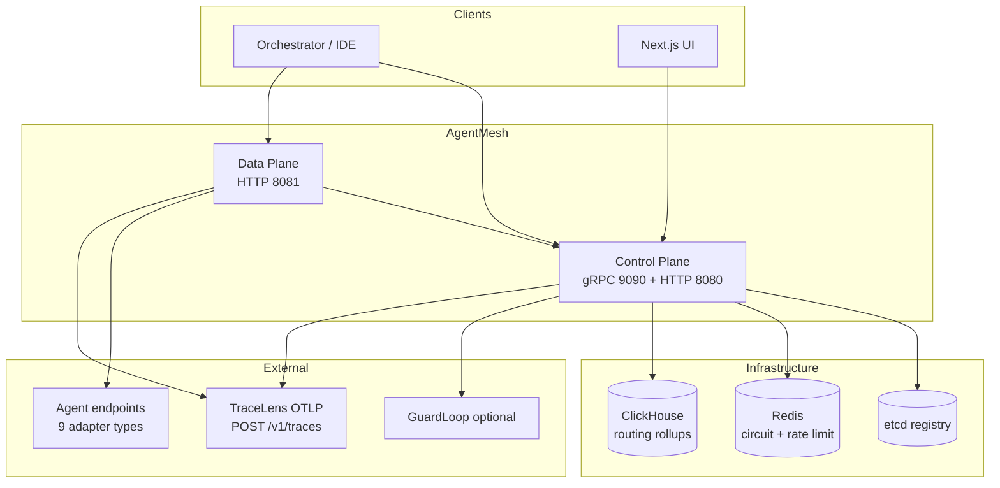
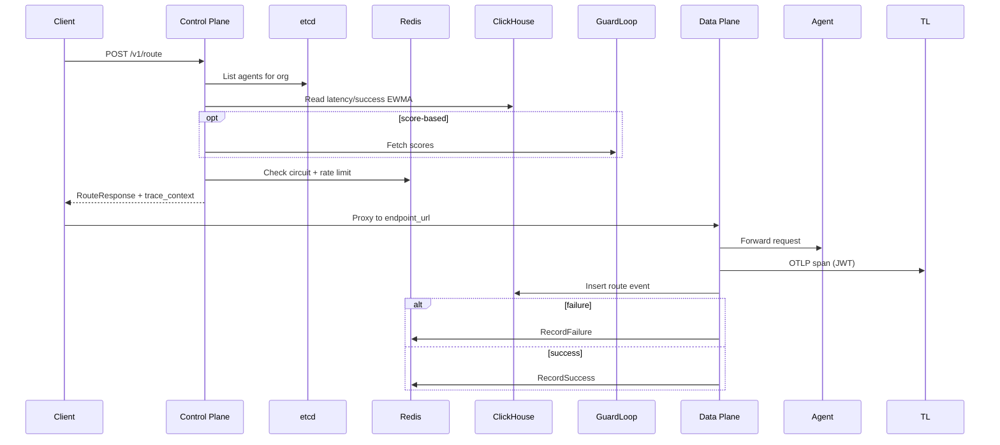

# Architecture

AgentMesh separates **control plane** (registry, routing decisions, REST/gRPC API) from **data plane** (request proxy, tracing, short-lived route cache). Both are implemented in **Go 1.22**.

## System context

## Request flow (route)

## Control plane

- **gRPC** implements `RegisterAgent`, `DiscoverAgents`, `RouteRequest`, `ReportHealth`, `GetCircuitState`.
- **REST gateway** (`internal/rest`) translates JSON to gRPC for `/v1/*`.
- **Router engine** applies strategy plugins; `score-based` delegates to GuardLoop when enabled.

## Data plane

- Mode `gateway` (default): proxies to selected `endpoint_url` with timeout and retries from config.
- **TraceLens**: OpenTelemetry OTLP HTTP exporter to `TRACELENS_OTLP_ENDPOINT` with optional `TRACELENS_JWT`. This is **not** Jaeger.
- Short **route cache** (`DATAPLANE_ROUTE_CACHE_TTL_MS`) reduces duplicate control plane calls.

## Multi-tenancy

Authentication binds requests to `org_id` via API key validation and headers `X-Org-ID` / `X-Workspace-ID`. etcd keys use configurable prefix (`ETCD_PREFIX`, default `/agentmesh`).

## Deployment topology

Kubernetes: Helm chart `deploy/helm/agentmesh` deploys control plane with **HorizontalPodAutoscaler** (CPU 70%, 2–20 replicas) and **PodDisruptionBudget** (`minAvailable: 1`). Data plane may run as sibling Deployment (compose locally).

## Failure domains

| Component | Blast radius | Mitigation |
|-----------|--------------|------------|
| etcd | No registration/discovery | HA etcd cluster, PDB on control plane |
| Redis | Circuits/limits inaccurate | Redis Sentinel/Cluster |
| ClickHouse | Analytics lag | Async inserts, batch workers |
| GuardLoop | Score-based degrades | Timeout + fallback ranking |

## Related docs

- [13-TECH-STACK.md](13-TECH-STACK.md)
- [16-DB-SCHEMA.md](16-DB-SCHEMA.md)
- [15-DEPLOY.md](15-DEPLOY.md)
